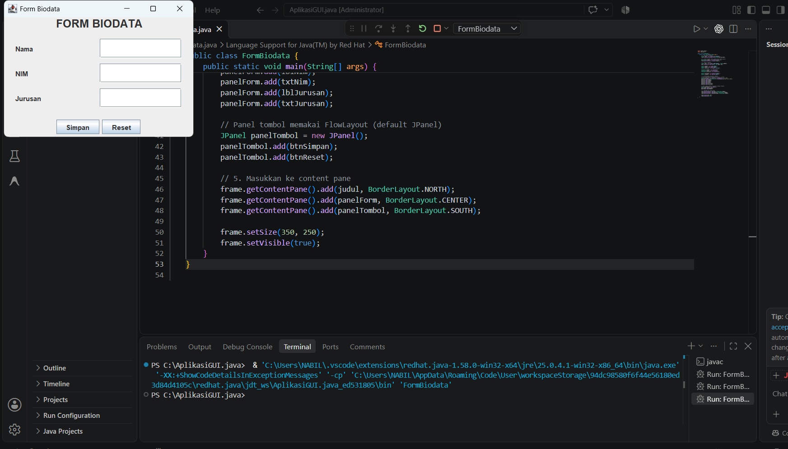

# Form Biodata (Java Swing)

Aplikasi GUI sederhana berbasis **Java Swing** yang menampilkan form biodata mahasiswa. Dibuat untuk mata kuliah **Pemrograman Berorientasi Objek (PBO)**, Pertemuan 10: *Graphical User Interface (GUI) di Java*.

## Identitas

| | |
|---|---|
| **Nama** | Nabil Naufal Anugrah|
| **NIM** | `[F1D02510127]` |
| **Mata Kuliah** | Pemrograman Berorientasi Objek |
| **Topik** | Latihan/Eksplorasi Materi GUI pada Java |

## Deskripsi

Program ini membuat satu jendela berisi form dengan tiga isian (Nama, NIM, Jurusan) dan dua tombol (Simpan dan Reset).

- Tombol **Simpan** memeriksa isian. Jika ada yang kosong, muncul dialog peringatan. Jika semua terisi, data ditampilkan lewat dialog.
- Tombol **Reset** mengosongkan semua isian.
- Aksi tombol ditangani dengan *Event Listener* (`ActionListener`).

## TAMPILAN PROGRAM




## Struktur Komponen

```
JFrame
 └─ Content Pane  [BorderLayout]
     ├─ NORTH  : JLabel "FORM BIODATA"
     ├─ CENTER : JPanel [GridLayout 3x2]
     │            ├─ JLabel "Nama"     + JTextField
     │            ├─ JLabel "NIM"      + JTextField
     │            └─ JLabel "Jurusan"  + JTextField
     └─ SOUTH  : JPanel [FlowLayout]
                  ├─ JButton "Simpan"
                  └─ JButton "Reset"
```

## Pemenuhan Ketentuan Latihan

| Yang diminta | Penerapan di kode |
|---|---|
| Top-level Container | `JFrame` sebagai jendela utama |
| Intermediate Container | `JPanel` (`panelForm` dan `panelTombol`) |
| Atomic Component | `JLabel`, `JTextField`, `JButton` |
| Layout Classes (minimal 2) | `BorderLayout`, `GridLayout`, `FlowLayout` |
| Event Listener | `implements ActionListener` dan override `actionPerformed()` |

## Konsep yang Digunakan

| Konsep | Penerapan di kode |
|---|---|
| Content pane | `frame.getContentPane()` untuk mengatur layout dan menambah komponen |
| `BorderLayout` | Tata letak utama jendela (NORTH, CENTER, SOUTH) |
| `GridLayout` | Tata letak form (3 baris x 2 kolom) |
| `FlowLayout` | Tata letak default `JPanel` untuk barisan tombol |
| Konstruktor | `new JFrame(...)`, `new JLabel(...)`, `new GridLayout(...)`, dan lainnya |
| Interface | `ActionListener` dengan method `actionPerformed()` yang wajib di-override |
| Dialog | `JOptionPane.showMessageDialog(...)` |

## Persyaratan

- **JDK 8 atau lebih baru** (disarankan JDK 17+)
- **Visual Studio Code** dengan ekstensi *Extension Pack for Java* (opsional, bisa juga lewat terminal)

Cek instalasi Java:

```bash
java -version
javac -version
```

## Cara Menjalankan

### Lewat VS Code

1. Buka folder proyek lewat *File → Open Folder*.
2. Pastikan file `FormBiodata.java` ada di dalam folder tersebut.
3. Buka `FormBiodata.java`, lalu klik tombol **▶ Run** di pojok kanan atas editor.

### Lewat terminal

```bash
javac FormBiodata.java
java FormBiodata
```

> Nama file harus `FormBiodata.java` karena nama class publiknya adalah `FormBiodata`.

## Struktur Repositori

```
PBO-GUI-FormBiodata/
├── FormBiodata.java
├── README.md
└── screenshots/
    ├── tampilan-awal.png
    ├── peringatan-kosong.png
    ├── data-tersimpan.png
    └── setelah-reset.png
```

## Penjelasan Singkat Kode

1. **Membuat jendela:** `JFrame` dibuat dengan judul "Form Biodata", dan `EXIT_ON_CLOSE` membuat program berhenti saat jendela ditutup.
2. **Mengatur layout:** `BorderLayout(5, 5)` dipasang pada content pane.
3. **Membuat komponen:** judul, tiga label, tiga kolom isian, dan dua tombol.
4. **Mendaftarkan listener:** tombol didaftarkan dengan `addActionListener(this)`.
5. **Mengelompokkan:** `panelForm` (`GridLayout 3x2`) untuk label dan isian, `panelTombol` (`FlowLayout`) untuk tombol.
6. **Menyusun:** judul di NORTH, form di CENTER, tombol di SOUTH.
7. **Menampilkan:** ukuran jendela 350 x 250 piksel, lalu `setVisible(true)`.
8. **Menangani klik:** `actionPerformed()` memeriksa tombol mana yang diklik lewat `e.getSource()`, lalu menjalankan aksi Simpan atau Reset.

